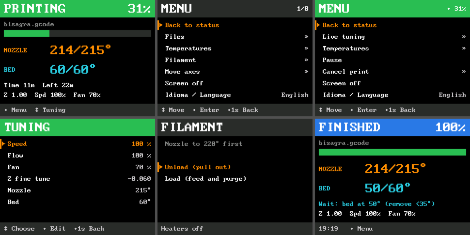

# Stock display for the Kobra Neo under Klipper

***Experimental — USE AT YOUR OWN RISK.*** Tested only on an Anycubic **Kobra Neo**
(HC32F460 board, stock ST7789V 320×240 TFT and rotary knob). The Kobra Go may use the
same display and pins, but it has not been tested.

With Klipper the stock display normally stays black. This folder brings it back as a
real Klipper screen, driven entirely from the printer's own knob:



## Features

- **Status page:** state, file name, progress bar and percentage (calculated like Fluidd),
  nozzle and bed temperatures, elapsed and remaining time, Z, speed and fan.
- **G-code preview:** if the G-code contains a thumbnail (e.g. sliced in OrcaSlicer with
  `thumbnails = 96x96/PNG`), it is shown next to the temperatures while printing.
  Files without a thumbnail show nothing.
- **Menus:** live tuning (speed, flow, fan, Z offset, temperatures), pause / resume /
  cancel, temperatures and presets, files, filament load/unload wizard, move axes, info.
- **Knob gestures:** turn = move / change, press = enter / accept, hold ~1 s = back / undo,
  hold 2 s = confirm dangerous actions (cancel print). Long presses trigger while held.
- **Languages:** English (default) and Spanish, selectable in the menu
  ("Idioma / Language"). The choice is saved in `preferencias.json` next to the config.
- Returns to the status page after 60 s untouched; backlight turns off after 15 min idle.
- Boot animation and a colour test chart (`TFT_CARTA`).

## Why a firmware patch is needed

Upstream Klipper has **no SPI support for the HC32F460**, so the display cannot be driven
with a stock build. `firmware/hc32f460-spi-tft.patch` adds:

1. **Hardware SPI2** on PC5 (SCK) / PC4 (MOSI) — the display pins used by Anycubic —
   as bus `spi2_PC5_PC4`. It also enables Klipper's software SPI on this MCU.
   Every wait has a 1 ms timeout, so an SPI fault shuts down with a clear message
   ("SPI timeout waiting for …") instead of hanging the board.
2. Two generic commands, **`spi_fill`** (repeat one colour N pixels) and **`spi_glyph`**
   (expand a 1-bit glyph to colour), so the board generates the pixels itself.
   The USB serial link (~40 KB/s at 500000 baud) is the bottleneck: with these commands a
   full screen redraw drops from ~4 s to ~0.25 s. The Python module detects them and falls
   back to plain `spi_send` if the firmware does not have them.

The patch is against Klipper **v0.13.0-800 (commit `9cb99754c`)**.

## Installation

1. **Update Klipper on the host** to v0.13.0-800 or newer, so the host matches the firmware.
2. **Build the firmware:**
   ```sh
   cd ~/klipper
   git apply /path/to/stock_display/firmware/hc32f460-spi-tft.patch
   cp /path/to/stock_display/firmware/kobra_neo.config .config
   make olddefconfig
   make
   ```
   `kobra_neo.config` selects HC32F460, 168 MHz, bootloader offset 0x8000, serial on
   PA3/PA2 at **500000 baud**.
3. **Flash it:** copy `out/klipper.bin` as `firmware.bin` to the root of a FAT32 microSD card
   (32 GB or smaller), power off the printer, insert the card, power on and wait a few minutes.
4. **printer.cfg:** set the baud rate and include the display:
   ```ini
   [mcu]
   serial: /dev/serial/by-id/...   # your printer
   baud: 500000

   [include kobra_tft.cfg]
   ```
5. **Install the module:**
   ```sh
   ln -s /path/to/stock_display/kobra_tft.py ~/klipper/klippy/extras/kobra_tft.py
   cp /path/to/stock_display/kobra_tft.cfg ~/printer_data/config/
   sudo systemctl restart klipper
   ```
   Restart the Klipper **service** after updating `kobra_tft.py`: a `RESTART` command does
   not reload Python modules. The log shows
   `kobra_tft: pixeles generados en la placa: si` when the fast firmware commands are in use.

Moonraker (`http://127.0.0.1:7125` by default) is used only for the Fluidd-style progress
and the thumbnails; without it the display falls back to Klipper's own progress.

## Commands

- `TFT_CARTA` — show a colour test chart (touch the knob to exit).
  `TFT_CARTA GAMMA=anycubic|estandar|viva` tries another panel gamma curve live;
  `TFT_CARTA SALIR=1` closes the chart.

## Known limitations

- When Klipper shuts down (thermal runaway, lost MCU, emergency stop) the screen freezes on
  its last image: the display is driven by the board, and a shut-down MCU rejects commands.
- The code and its comments are in Spanish; the on-screen texts are English or Spanish.
- No buzzer support: the Neo's firmware sources mention a beeper on PB7, but on the tested
  board nothing sounds.

## Credits

- Pins and the ST7789V init sequence come from Anycubic's Kobra Neo firmware sources.
- Built on [Klipper](https://www.klipper3d.org/) and on this repository's Kobra Neo configs.

Licensed under the GNU GPLv3, like Klipper.
